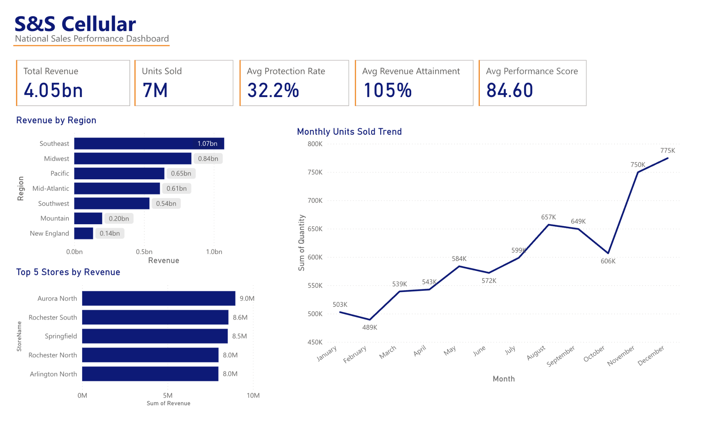
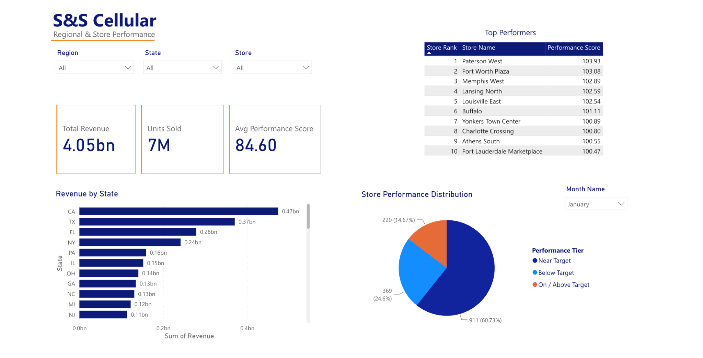
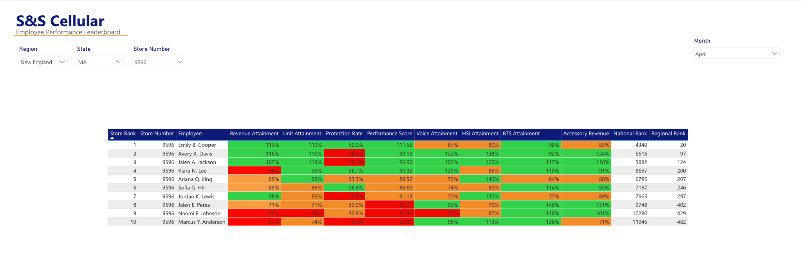

# Tech Sales Performance Dashboard

An interactive Power BI analytics project examining nationwide retail sales performance for S&S Cellular, a fictional telecommunications retailer. The dashboard transforms simulated sales and employee performance data into insights that support operational decision-making.

## Project Overview

This project was developed to evaluate sales performance across retail stores, geographic regions, and individual employees. It provides an interactive reporting environment for comparing performance against targets, identifying trends, and highlighting opportunities for improvement.

**Key objectives:**
- Evaluate revenue and sales volume across regions and stores.
- Compare employee and store performance against established targets.
- Analyze protection attachment rates and product-related sales metrics.
- Identify top performers and areas requiring additional coaching.
- Support data-driven retail performance management.

## Tools & Technical Skills

- **Power BI:** Interactive dashboard design, KPI cards, charts, slicers, and reporting.
- **DAX:** Calculated measures, performance scores, attainment calculations, and rankings.
- **Data Modeling:** Table relationships and aggregation of transactional and performance data.
- **Data Analysis:** Trend analysis, performance benchmarking, and business recommendations.

## Dashboard Preview

### 1. Executive Overview

Provides a nationwide summary of revenue, units sold, protection attachment, revenue attainment, and overall performance, including regional comparisons and monthly sales trends.

### 2. Regional & Store Performance

Allows users to examine revenue by state, identify top-performing stores, and evaluate monthly store performance distributions using interactive filters.

### 3. Employee Performance Leaderboard

Compares employee performance using sales attainment, protection attachment rates, performance scores, and regional and national rankings.

## Analytical Approach

1. Organized simulated retail sales, employee, store, product, and performance data.
2. Developed a Power BI data model to support reporting across multiple business dimensions.
3. Used DAX calculations to measure target attainment, performance scores, and rankings.
4. Created interactive visuals and slicers to explore results by geographic location, store, employee, and month.
5. Evaluated performance differences to identify potential operational improvements.

## Business Applications

The dashboard supports retail management decisions by helping users identify performance gaps, prioritize coaching, compare store results, and track progress toward sales objectives.

Potential actions include targeted employee training, manager-led performance observations, and additional support for locations consistently below target.

## Project Files

- [Power BI Dashboard (.pbix)](techsalesdashboard.pbix)
- [Executive Overview](screenshots/executive_overview.png)
- [Regional & Store Performance](screenshots/regional_performance.png)
- [Employee Leaderboard](screenshots/employee_leaderboard.png)

## Data Disclaimer

This is an independent portfolio project using fictional company information and simulated retail data. It does not represent actual company financial or employee performance records.
